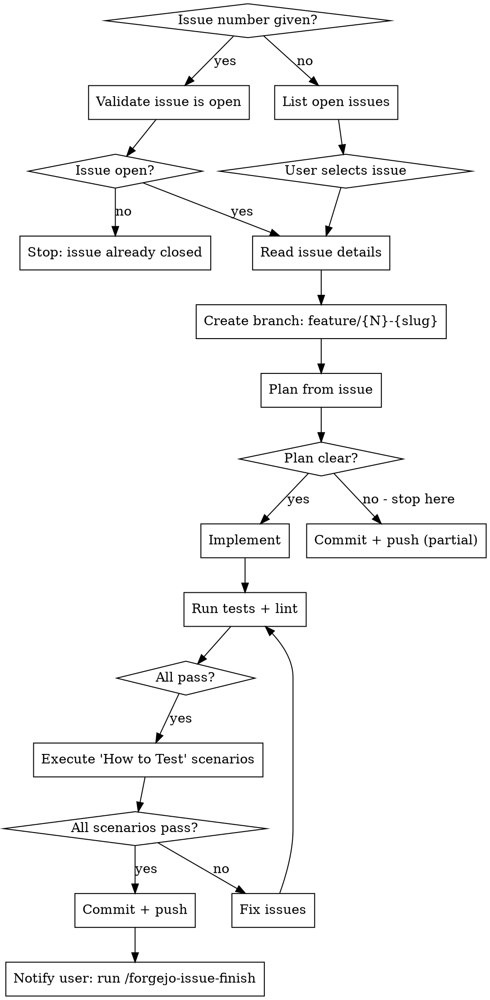

## Pre-requisites

- forgejo-mcp server must be available and successfully connected. Verify by checking that forgejo-mcp tools are listed. If not available: inform the user that the forgejo-mcp MCP server is not connected, and **abort immediately**. Do NOT attempt workarounds such as REST API calls, curl, or any other method — the MCP server is the only supported interface.

# Forgejo Issue Management

Uses the `forgejo-mcp` MCP server (configured globally in `~/.claude.json`) to interact with issues on any Forgejo project.

## Full Workflow



## Autonomy principle

**Minimize user interaction.** Only stop to ask if genuinely blocked. Never pause to confirm next steps when the path forward is clear. Keep moving.

The only required user input in the entire workflow is choosing which issue to work on (step 1, when no issue number is given). Everything else runs automatically.

**Done when:** the issue is implemented, tests and lint pass, all test scenarios pass, the branch is pushed and the ntfy is sent.
If any user input is required or the whole workflow is done, notify by delegating to the **`ntfy-me`** skill with:

| Parameter | Value |
|-----------|-------|
| `--topic` | `claude` |
| `--title` | `<status title>` |
| body | `<message>` |

## Steps

### 1. Detect repo and select issue

Derive owner and repo from git remote, never hardcode:

```bash
git remote get-url origin
# https://forgejo.home.janbaer.de/owner/repo.git → owner="owner", repo="repo"
```

**If an issue number was passed as argument:**

```
get_issue_by_index(owner, repo, index=N)
```

Check `state` in the response. If `state != "open"`, stop and inform the user the issue is already closed. If `hermes-agent` is among its `assignees`, stop and say that Hermes owns it; continue only if Jan explicitly asks Claude to take it over. Otherwise skip straight to step 2.

**If no issue number was given:**

```
list_repo_issues(owner, repo, state="open")
```

Leave out issues whose `assignees` include `hermes-agent`; the MCP tools cannot filter by assignee, so check the field on each result. Show a numbered summary of the rest, and mark the ones labelled `blocked`. Ask the user which to work on. **This is the only point where user input is required.**

### 2. Read the issue

```
get_issue_by_index(owner, repo, index=N)
list_issue_comments(owner, repo, index=N)
```

Understand what the issue is about before doing anything else.

### 3. Create feature branch

Ensure the main branch is checked out and up to date before branching:

```bash
git checkout main
git pull
git checkout -b feature/42-fix-login-redirect
```

Branch name: `feature/{issue-number}-{short-slug}`

### 4. Plan

Write a short plan from the issue: approach and files to touch. Keep it as long as the change needs; a one-line fix gets one line.

### 4a. Requirements and design

If the repo has `docs/requirements.md`, run the **forgejo-project-interview** skill in `update` mode with this issue number, after the plan exists and before implementing. It decides whether the `## Requirement` section of the issue adds, changes or drops a requirement and whether a design decision was made. The document changes belong in the same commit series as the code and end up in the same PR. For an issue that is not blocked it asks only before changing or dropping an existing requirement.

### 5. Evaluate clarity and check whether the issue is blocked

After the plan exists (step 4), check the issue's labels (fetched in step 2). An issue is blocked when it carries the `blocked` label, or, for issues created before the label existed, when its body has `Claude: Needs feedback first`.

**If blocked:**
- Show what blocks it: the latest comment that starts with `Blocked:`, or the open point in the body
- Present the plan (proposed approach, design decisions, steps) and how it depends on that open point
- Wait for the user's answer or corrections before proceeding
- Once the user has resolved it, remove the `blocked` label (`remove_issue_labels`) and continue to step 6

**If not blocked:**
- Assess whether the plan is clear enough to implement without asking the user
- **Clear** → proceed to implementation without pausing
- **Not clear** → commit what exists, push the branch, then explain to the user what is ambiguous and what decision is needed
- When in doubt, lean toward continuing. Only stop if implementation truly cannot proceed without a decision that only the user can make.

### 6. Implement

Follow the plan from step 4. Work through it in order without stopping for confirmation between steps. Implement only what is planned; mention anything extra at the end instead of building it.

### 7. Run tests and lint

Run the project's test and lint commands before committing. Fix failures before proceeding — do not ask the user whether to fix them.

### 8. Execute the "How to Test" scenarios

Re-read the **"How to Test"** section from the original issue (fetched in step 2). Execute every scenario described there — use the browser via Chrome DevTools MCP tools if the issue requires UI interaction. This is **mandatory**, not optional.

- If all scenarios pass → proceed to commit
- If any scenario fails → fix the issue, re-run tests and lint, then re-verify all scenarios

Do not skip this step even if automated tests pass. Automated tests verify correctness; the "How to Test" scenarios verify that the feature works as the user intended.

Before committing, check once more whether the implementation forced a decision that the design documents (`docs/design.md`, `docs/services/`, `docs/roles/`) do not list yet. Add it via the `update` mode of **forgejo-project-interview**.

### 9. Commit and push

```bash
git add <files>
git commit -m "<message>"
git push -u origin feature/42-fix-login-redirect
```

After pushing, send a notification via the **`ntfy-me`** skill:

| Parameter | Value |
|-----------|-------|
| `--topic` | `claude` |
| `--title` | `Implementation pushed` |
| body | `Ready for your review. Run /forgejo-issue-finish when done.` |

The skill ends here. Archive and PR creation are handled by `/forgejo-issue-finish` once the user has verified the implementation manually.

## MCP Tools Reference

| Tool | Use case |
|------|----------|
| `list_repo_issues` | Browse open issues |
| `get_issue_by_index` | Read issue details or validate state |
| `list_issue_comments` | Read issue discussion |
| `remove_issue_labels` | Drop `blocked` once the open point is resolved |
