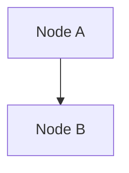

# Obsidian formatting

## Contents

- Internal Links (Wikilinks)
- Embeds
- Callouts
- Properties (Frontmatter)
- Comments and Highlights
- Visualizations

Standard Markdown is assumed. Use these Obsidian-specific extensions when writing note content.

### Internal Links (Wikilinks)

Always use wikilinks for vault-internal references; use `[text](url)` only for external URLs.

```markdown
[[Note Name]]                    Link to note
[[Note Name|Display Text]]       Custom display text
[[Note Name#Heading]]            Link to specific heading
[[Note Name#^block-id]]          Link to specific block
[[#Heading in same note]]        Same-note heading link
```

Define a block ID by appending `^block-id` to a paragraph (or on a separate line after a list/quote block).

### Embeds

Prefix any wikilink with `!` to embed content inline:

```markdown
![[Note Name]]                   Embed full note
![[Note Name#Heading]]           Embed section
![[image.png]]                   Embed image
![[image.png|300]]               Embed image with fixed width
![[document.pdf#page=3]]         Embed PDF page
```

### Callouts

```markdown
> [!note]
> Basic callout.

> [!warning] Custom Title
> Callout with a custom title.

> [!faq]- Collapsed by default
> Foldable callout (- collapsed, + expanded).
```

Common types: `note`, `tip`, `info`, `warning`, `danger`, `success`, `failure`, `question`, `example`, `quote`, `bug`, `abstract`, `todo`.

### Properties (Frontmatter)

```yaml
---
title: My Note
date: 2024-01-15
tags:
  - project
  - active
aliases:
  - Alternative Name
cssclasses:
  - custom-class
---
```

- `tags` — searchable labels; also usable inline as `#tag` or `#nested/tag`
- `aliases` — alternative note names surfaced in link suggestions
- `cssclasses` — CSS classes applied to the note in reading view
- Tags may contain letters, numbers (not first character), underscores, hyphens, and forward slashes

### Comments and Highlights

```markdown
This is visible %%but this is hidden%% text.

%%
This entire block is hidden in reading view.
%%

==Highlighted text==
```

### Visualizations

When the user asks for a visualization, diagram, or chart in an Obsidian note, **always use Mermaid** — it is built into Obsidian and requires no plugin.

```markdown

```

**Important:** Use `<br/>` for line breaks inside node labels — `\n` is rendered literally and does not produce a line break:

```
✅  A["First line<br/>Second line"]
❌  A["First line\nSecond line"]
```

Supported Mermaid diagram types (all work natively in Obsidian):

| Type | Syntax | Use case |
|---|---|---|
| Flowchart | `flowchart TD` / `LR` | Prozesse, Abhängigkeiten, Entscheidungsbäume |
| Sequence | `sequenceDiagram` | Kommunikation zwischen Systemen/Services |
| Gantt | `gantt` | Zeitpläne, Projektplanung |
| Class | `classDiagram` | Datenmodelle, OOP-Strukturen |
| State | `stateDiagram-v2` | Zustandsautomaten, Lifecycle-Diagramme |
| Pie | `pie` | Einfache Anteile/Verteilungen |
| Git | `gitGraph` | Branch-Strategien |
| ER | `erDiagram` | Datenbankschemas |

**Other visualization options (require plugins):**

- **Excalidraw** (`obsidian-excalidraw-plugin`) — Hand-drawn style, freie Zeichenfläche, sehr beliebt für Architekturen
- **Dataview** (`dataview`) — Tabellen und Listen aus Vault-Metadaten abfragen (kein Chart, aber strukturierte Daten)
- **Charts** (`obsidian-charts`) — Bar-, Line-, Pie-Charts via YAML-Block
- **PlantUML** (`plantuml`) — Alternative zu Mermaid für UML

Für den Standardfall immer **Mermaid** verwenden — kein Plugin, kein Setup, funktioniert sofort.
